# EduRoute

An adaptive examination, real-time anti-cheat, and zero-loss synchronization engine. Engineered with a pure **C++20 core** executing under microsecond latency budgets (< 50 $\mu$s per packet) and a lightweight web interface designed for low-power devices and 2G mobile networks.

---

## Architecture Overview

```mermaid
flowchart TD

subgraph group_web["Exam dashboard & Client Layer"]
  node_dashboard["Flask web app<br/>[dashboard/app.py]"]
  node_bridge["C-ABI ctypes bridge<br/>[dashboard/bridge.py]"]
  node_questions["Question bank UI<br/>[dashboard/questions.py]"]
  node_disk["Local disk cache & queue<br/>(localStorage / IndexedDB)"]
end

subgraph group_api["Engine C ABI Gateway"]
  node_engine["C ABI engine controller<br/>[src/eduroute_c_api.cpp]"]
  node_abi["Public C API headers<br/>[include/eduroute_c_api.h]"]
end

subgraph group_adaptive["Division 3: Adaptive Ranking"]
  node_irt["IRT Fisher selector<br/>[src/adaptive_rank/irt_selector.cpp]"]
  node_fenwick["Fenwick percentile tree<br/>[src/adaptive_rank/fenwick_score.cpp]"]
  node_avl["Order-Stat AVL rank tree<br/>[src/adaptive_rank/order_stat_avl.cpp]"]
end

subgraph group_integrity["Division 2: Anti-Cheat & Collusion"]
  node_anomaly["Anomaly statistics<br/>[src/anticheat/anomaly_stats.cpp]"]
  node_kmer["K-mer winnowing similarity<br/>[src/anticheat/kmer_winnow.cpp]"]
  node_collusion["Collusion graph & DSU<br/>[src/anticheat/collusion_graph.cpp]"]
end

subgraph group_sync["Division 1: Synchronization & Persistence"]
  node_merkle[("Merkle DAG answer history<br/>[src/sync_engine/merkle_dag.cpp]")]
  node_huffman["Huffman delta compressor<br/>[src/sync_engine/huffman_delta.cpp]"]
  node_wal[("Write-ahead log ring buffer<br/>[src/sync_engine/wal_ring.cpp]")]
end

subgraph group_core["Core Zero-STL Primitives"]
  node_arena["Bump arena allocator<br/>[include/core/arena_alloc.hpp]"]
  node_containers["Core hash map & dyn array<br/>[include/core/hash_map.hpp]"]
end

node_student(("Student"))

node_student -->|"types & submits answers"| node_dashboard
node_student -.->|"buffers while offline"| node_disk
node_disk -.->|"recovers & replays on reconnect"| node_dashboard
node_dashboard -->|"uses bridge"| node_bridge
node_dashboard -->|"loads questions"| node_questions
node_bridge -->|"calls C ABI"| node_engine
node_engine -->|"implements"| node_abi

node_engine -->|"selects optimal questions"| node_irt
node_engine -->|"updates score distribution"| node_fenwick
node_engine -->|"queries live rank"| node_avl

node_engine -->|"records temporal & error anomalies"| node_anomaly
node_engine -->|"extracts winnowed fingerprints"| node_kmer
node_engine -->|"merges cheating clusters (W >= 3.0)"| node_collusion

node_engine -->|"records cryptographic history"| node_merkle
node_engine -->|"compresses revision deltas"| node_huffman
node_engine -->|"persists frames before state mutation"| node_wal
node_wal -->|"stores compressed deltas on disk"| node_huffman

node_engine -->|"allocates persistent & scratch state"| node_arena
node_anomaly -->|"indexes coincidence pairs"| node_containers
node_collusion -->|"maintains graph state"| node_containers

classDef toneNeutral fill:#f8fafc,stroke:#334155,stroke-width:1.5px,color:#0f172a
classDef toneBlue fill:#dbeafe,stroke:#2563eb,stroke-width:1.5px,color:#172554
classDef toneAmber fill:#fef3c7,stroke:#d97706,stroke-width:1.5px,color:#78350f
classDef toneMint fill:#dcfce7,stroke:#16a34a,stroke-width:1.5px,color:#14532d
classDef toneRose fill:#ffe4e6,stroke:#e11d48,stroke-width:1.5px,color:#881337
classDef toneIndigo fill:#e0e7ff,stroke:#4f46e5,stroke-width:1.5px,color:#312e81
classDef toneTeal fill:#ccfbf1,stroke:#0f766e,stroke-width:1.5px,color:#134e4a

class node_dashboard,node_bridge,node_questions,node_disk toneBlue
class node_engine,node_abi toneAmber
class node_irt,node_fenwick,node_avl toneMint
class node_anomaly,node_kmer,node_collusion toneRose
class node_merkle,node_huffman,node_wal,node_student toneIndigo
class node_arena,node_containers toneTeal
```



---

## Key Features

### 1. Division 1: Zero-Loss Synchronization & Offline Resilience
- **Dynamic Huffman Delta Compression**: Calculates binary differences between answer snapshots, compressing them with dynamic 256-symbol Huffman trees for **75%+ bandwidth reduction**.
- **Append-Only Write-Ahead Log (WAL Ring)**: Disk-backed frame logging with magic header `0x7f, 'C', 'A', 'T'`, sequence tracking, and FNV-1a checksums.
- **Cryptographic Merkle DAG**: Immutable parent-child hash chaining on disk (`.dag`) preventing historical tampering.
- **Client-Side Edge Disk Buffering**: Continuous draft auto-save and offline submission queueing via browser disk storage (`localStorage`/IndexedDB). When internet connectivity drops, answers are safely stored and automatically replayed and synchronized upon reconnection.

### 2. Division 2: Real-Time Anti-Cheat & Collusion Network
- **K-mer Winnowing**: Sliding $k$-gram fingerprint extraction ($k=5, w=4$) with Rabin-Karp rolling hashes and inverted index matching.
- **$\Delta t$ Temporal Synchronization**: Statistical anomaly detection identifying students submitting answers within tight time windows ($\le 500\text{ ms}$).
- **Shared Rare-Error Indexing**: Detects suspicious shared mistakes on distractors selected by $< 15\%$ of the cohort.
- **Disjoint Set Union (DSU) Clustering**: Pairs exceeding combined weight $W(A, B) \ge 3.0$ are dynamically collapsed into cheating ring clusters.

### 3. Division 3: Adaptive Ranking & Evaluation
- **Item Response Theory (1PL Rasch)**: Dynamic ability estimation ($\theta$) via Newton-Raphson iteration and Fisher Information question routing.
- **Fenwick Tree Percentile Index**: $O(\log M)$ point updates and prefix frequency queries across scores $[0 .. 10000]$.
- **Order-Statistic AVL Tree**: $O(\log N)$ exact tie-broken live rank queries (Score $\downarrow$, Time $\uparrow$, Student ID $\uparrow$) without linear scans.

### 4. High-Performance Core
- Core engine has **0 dependencies on STL containers** (`std::vector`, `std::string`, `std::map`).
- **Two-Arena Memory Model**: Pre-allocated Persistent Arena for exam state and a 2 MB per-packet Scratch Arena with $O(1)$ bump-pointer reset, eliminating dynamic heap allocations on the hot path.

---

## Directory Layout

```
.
├── include/                  # Public C ABI and division C++ headers
│   ├── eduroute_c_api.h      # C ABI function declarations & exported structs
│   ├── core/                 # Zero-STL memory arena, array, hash map, DSU
│   ├── sync_engine/          # Huffman delta, WAL ring, Merkle DAG
│   ├── anticheat/            # K-mer winnowing, anomaly stats, collusion graph
│   └── adaptive_rank/        # IRT selector, Fenwick tree, Order-Stat AVL
├── src/                      # C++ engine implementations
│   ├── eduroute_c_api.cpp    # Unified engine coordinator & C ABI exports
│   ├── sync_engine/          # WAL, Merkle DAG, and Huffman compression logic
│   ├── anticheat/            # Anti-cheat detectors & collusion graph
│   └── adaptive_rank/        # Adaptive scoring, AVL tree, and Fenwick tree
├── dashboard/                # Low-bandwidth Flask web application
│   ├── app.py                # Web server routes & offline sync endpoints
│   ├── bridge.py             # Python ctypes wrapper over libeduroute.so
│   ├── questions.py          # Calibrated question bank definitions
│   ├── templates/            # HTML5 templates with local disk auto-save
│   └── run.sh                # Webapp startup script
├── test/                     # Unit test and high-load simulator suites
│   ├── test_adts.cpp         # 18 unit test suites (344 assertions)
│   └── stress_sim.cpp        # 12,000+ ops/sec concurrent stress simulator
├── docs/                     # In-depth architectural & API documentation
│   ├── ARCHITECTURE.md       # Full architecture & Mermaid dataflow diagrams
│   ├── API_REFERENCE.md      # Complete C ABI and REST API documentation
│   ├── OFFLINE_RECOVERY_AND_SYNC.md # Detailed edge offline & WAL disk recovery
│   └── STATIC_ANALYSIS.md    # Static analysis report (cloc, cppcheck, nm)
├── CMakeLists.txt            # CMake build configuration
└── LICENSE                   # GNU General Public License v3.0
```

---

## Quick Start

### 1. Requirements
- C++20 compatible compiler (`g++` $\ge$ 11 or `clang++` $\ge$ 13)
- `cmake` ($\ge$ 3.16)
- Python 3.8+ (with `flask` for dashboard)

### 2. Build the C++ Engine & Tests
```bash
cmake -B build -DCMAKE_BUILD_TYPE=Debug
cmake --build build

# Output binaries:
#   build/libeduroute_engine.a   (Static engine core)
#   dashboard/libeduroute.so     (Shared C ABI library)
#   build/test_adts              (Unit test suite)
#   build/stress_sim             (High-throughput simulator)
```

### 3. Run Unit Tests
```bash
./build/test_adts
# -> Test Results: 344/344 assertions PASSED (0 failed) across 18 suites
```

### 4. Run Stress & Recovery Simulator
```bash
./build/stress_sim
# -> Ingest Throughput: ~12,000+ packets/sec
# -> Bandwidth Savings: ~75.02% (Huffman Delta)
# -> On-Disk Recovery: 100% of DAG & WAL states recovered from disk
```

### 5. Launch Web Application
```bash
cd dashboard
./run.sh
# Server running at http://0.0.0.0:5000
```
- Open `http://localhost:5000/exam?student_id=1` to take an adaptive exam.
- Toggle **" Simulate Internet Disconnect"** to test continuous local disk auto-save, offline queueing, and automatic reconnection recovery.
- Open `http://localhost:5000/dashboard` to view live AVL rankings, confirmed collusion edges, WAL persistence metrics, and test the interactive Huffman compression playground.

---

## Documentation

For in-depth technical documentation, refer to the [`docs/`](docs/) directory:
- [System Architecture & Component Diagrams](docs/ARCHITECTURE.md)
- [C ABI & REST API Reference](docs/API_REFERENCE.md)
- [Offline Resilience, Huffman Compression & Disk Recovery](docs/OFFLINE_RECOVERY_AND_SYNC.md)
- [Static Analysis & Code Quality Report](docs/STATIC_ANALYSIS.md)

---

## License & Authors
Copyright (c) 2026 Team NextEval @ NITT
- Raj `<106125091@nitt.edu>`
- Raswanth `<raswanthvenkatesan2007@gmail.com>`
- Rithimoni `<rithimonisubaramanian@gmail.com>`  

This project is licensed under the GNU General Public License v3.0 - see the [LICENSE](LICENSE) file for details.