# EduRoute

## NOTE: ITS PARTIAL FOR NOW

```mermaid

flowchart TD

subgraph group_web["Exam dashboard"]
  node_dashboard["Flask app<br/>[app.py]"]
  node_bridge["Engine bridge<br/>[bridge.py]"]
  node_questions["Question bank UI<br/>[questions.py]"]
end

subgraph group_api["Engine API"]
  node_engine["C ABI engine<br/>[eduroute_c_api.cpp]"]
  node_abi["Public C API<br/>[eduroute_c_api.h]"]
end

subgraph group_adaptive["Adaptive ranking"]
  node_irt["IRT selector<br/>[irt_selector.cpp]"]
  node_fenwick["Score index<br/>[fenwick_score.cpp]"]
  node_avl["Rank tree<br/>[order_stat_avl.cpp]"]
end

subgraph group_integrity["Anti-cheat"]
  node_anomaly["Anomaly statistics<br/>[anomaly_stats.cpp]"]
  node_kmer["Text similarity<br/>[kmer_winnow.cpp]"]
  node_collusion["Collusion graph"]
end

subgraph group_sync["Synchronization"]
  node_merkle[("Answer history<br/>[merkle_dag.cpp]")]
  node_huffman["Delta compression<br/>[huffman_delta.cpp]"]
  node_wal[("Write-ahead log<br/>[wal_ring.cpp]")]
end

subgraph group_core["Core structures"]
  node_arena["Arena allocator<br/>[arena_alloc.hpp]"]
  node_containers["Core containers<br/>[hash_map.hpp]"]
end

node_student(("Student"))

node_student -->|"submits answers"| node_dashboard
node_dashboard -->|"uses bridge"| node_bridge
node_dashboard -->|"loads questions"| node_questions
node_dashboard -.->|"requests engine results"| node_bridge
node_bridge -.->|"calls C ABI"| node_engine
node_engine -->|"implements"| node_abi
node_engine -->|"selects questions"| node_irt
node_engine -->|"queries percentiles"| node_fenwick
node_engine -->|"queries rank"| node_avl
node_engine -->|"records anomalies"| node_anomaly
node_engine -->|"extracts fingerprints"| node_kmer
node_engine -->|"updates collusion"| node_collusion
node_engine -->|"uses answer history"| node_merkle
node_engine -->|"uses compression"| node_huffman
node_engine -->|"uses log"| node_wal
node_wal -->|"stores compressed deltas"| node_huffman
node_engine -->|"allocates engine state"| node_arena
node_anomaly -->|"stores pair scores"| node_containers
node_collusion -->|"stores graph state"| node_containers
node_irt -->|"uses arena"| node_arena
node_merkle -->|"stores snapshots"| node_arena

click node_dashboard "https://github.com/nextevaldevs/eduroute/blob/main/dashboard/app.py"
click node_bridge "https://github.com/nextevaldevs/eduroute/blob/main/dashboard/bridge.py"
click node_questions "https://github.com/nextevaldevs/eduroute/blob/main/dashboard/questions.py"
click node_engine "https://github.com/nextevaldevs/eduroute/blob/main/src/eduroute_c_api.cpp"
click node_abi "https://github.com/nextevaldevs/eduroute/blob/main/include/eduroute_c_api.h"
click node_irt "https://github.com/nextevaldevs/eduroute/blob/main/src/adaptive_rank/irt_selector.cpp"
click node_fenwick "https://github.com/nextevaldevs/eduroute/blob/main/src/adaptive_rank/fenwick_score.cpp"
click node_avl "https://github.com/nextevaldevs/eduroute/blob/main/src/adaptive_rank/order_stat_avl.cpp"
click node_anomaly "https://github.com/nextevaldevs/eduroute/blob/main/src/anticheat/anomaly_stats.cpp"
click node_kmer "https://github.com/nextevaldevs/eduroute/blob/main/src/anticheat/kmer_winnow.cpp"
click node_collusion "https://github.com/nextevaldevs/eduroute/blob/main/src/anticheat/collusion_graph.cpp"
click node_merkle "https://github.com/nextevaldevs/eduroute/blob/main/src/sync_engine/merkle_dag.cpp"
click node_huffman "https://github.com/nextevaldevs/eduroute/blob/main/src/sync_engine/huffman_delta.cpp"
click node_wal "https://github.com/nextevaldevs/eduroute/blob/main/src/sync_engine/wal_ring.cpp"
click node_arena "https://github.com/nextevaldevs/eduroute/blob/main/include/core/arena_alloc.hpp"
click node_containers "https://github.com/nextevaldevs/eduroute/blob/main/include/core/hash_map.hpp"

classDef toneNeutral fill:#f8fafc,stroke:#334155,stroke-width:1.5px,color:#0f172a
classDef toneBlue fill:#dbeafe,stroke:#2563eb,stroke-width:1.5px,color:#172554
classDef toneAmber fill:#fef3c7,stroke:#d97706,stroke-width:1.5px,color:#78350f
classDef toneMint fill:#dcfce7,stroke:#16a34a,stroke-width:1.5px,color:#14532d
classDef toneRose fill:#ffe4e6,stroke:#e11d48,stroke-width:1.5px,color:#881337
classDef toneIndigo fill:#e0e7ff,stroke:#4f46e5,stroke-width:1.5px,color:#312e81
classDef toneTeal fill:#ccfbf1,stroke:#0f766e,stroke-width:1.5px,color:#134e4a
class node_dashboard,node_bridge,node_questions toneBlue
class node_engine,node_abi toneAmber
class node_irt,node_fenwick,node_avl toneMint
class node_anomaly,node_kmer,node_collusion toneRose
class node_merkle,node_huffman,node_wal,node_student toneIndigo
class node_arena,node_containers toneTeal
```

## License & Authors
Copyright (c) 2026 Team NextEval @ NITT
- Raj <106125091@nitt.edu>
- Raswanth <raswanthvenkatesan2007@gmail.com>
- Rithimoni <rithimonisubaramanian@gmail.com>
This project is licensed under the GNU General Public License v3.0 - see the [LICENSE](LICENSE) file for details.