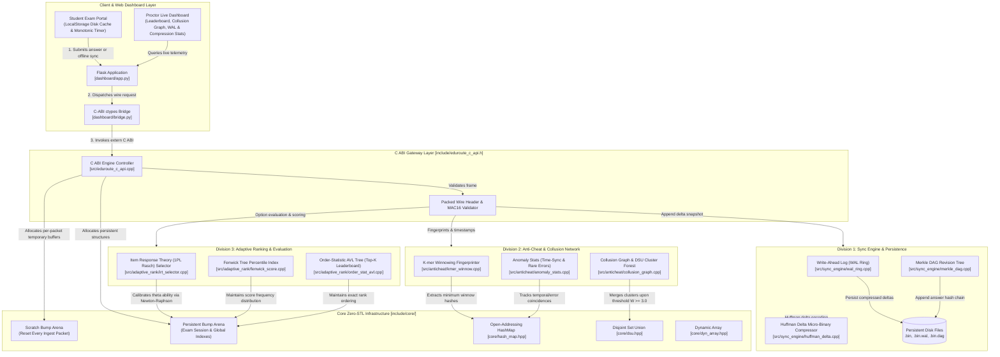
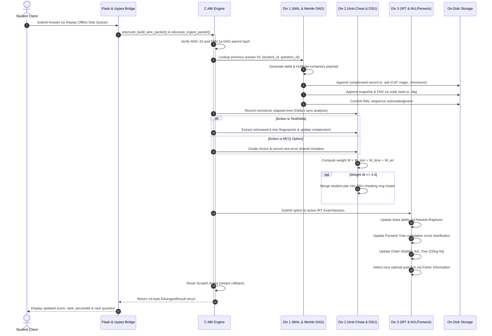
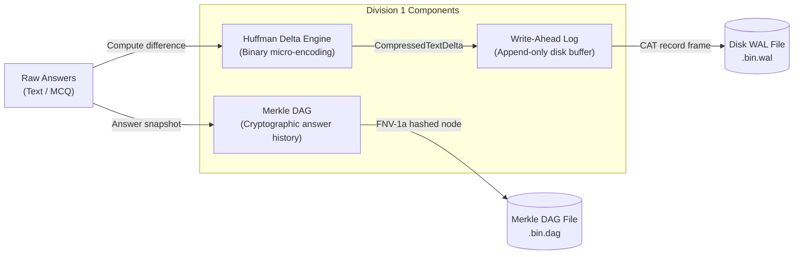
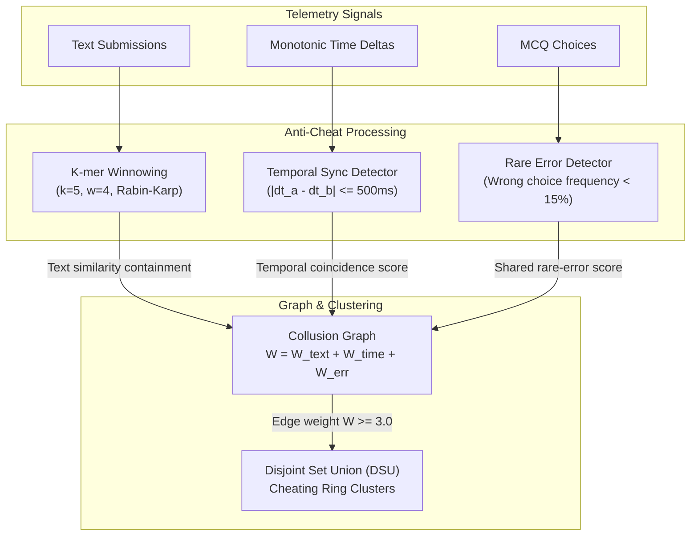
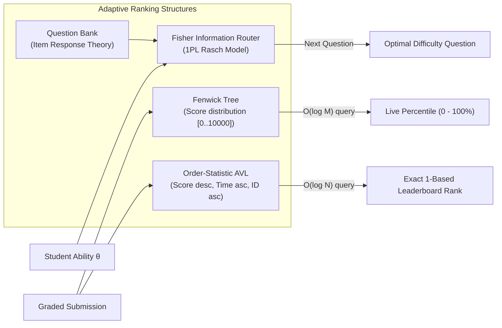
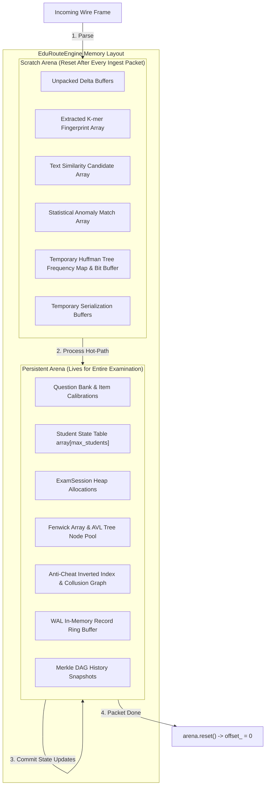

# EduRoute System Architecture

EduRoute is an adaptive examination, real-time integrity monitoring, and zero-loss synchronization engine. It features a zero-STL C++ core engineered for execution under strict memory boundaries (< 50 microseconds per ingestion packet) and a low-bandwidth web interface tailored for 2G networks and low-power client devices.

---

## 1. High-Level Architecture Overview

---

## 2. Ingestion Hot-Path Lifecycle

Every answer submission (MCQ or descriptive text revision) flows through a synchronous pipeline designed to execute in sub-millisecond time without heap allocations.

---

## 3. Division Architectural Breakdown

### Division 1: Synchronization & Persistence Subsystem

Division 1 guarantees zero data loss across network drops, sudden browser shutdowns, and power interruptions.

1. **Huffman Delta Micro-Binary Compressor (`huffman_delta.cpp`)**:
   - Generates minimal text differences between current draft and previous snapshot.
   - Computes dynamic 256-symbol frequency tables.
   - Encodes deltas into bitstream representations via custom `BitWriter`.
   - Typically achieves **50% to 85% bandwidth reduction** over raw ASCII deltas.
2. **Write-Ahead Log Ring (`wal_ring.cpp`)**:
   - Append-only file format with magic bytes `0x7f, 'C', 'A', 'T'` and file version 1.
   - Each record stores sequence, student ID, timestamp, Huffman frequency table (1024 bytes), and compressed bitstream payload.
   - Integrity verified using combined header-prefix and payload FNV-1a checksums.
   - Supports uncommitted states and sequence-based acknowledgments (`acknowledge(seq)`).
3. **Merkle DAG (`merkle_dag.cpp`)**:
   - Maintains an append-only cryptographic directed acyclic graph of student answer revisions.
   - Retains the 5 most recent snapshots per student-question pair in memory.
   - Nodes hashed deterministically via 64-bit FNV-1a combining `(student_id, question_id, parent_hash, timestamp, answer_bytes)`.
   - Replays on restart from the `.dag` disk file, restoring hash chains.

---

### Division 2: Real-Time Anti-Cheat & Collusion Subsystem

Division 2 detects real-time collusion networks between students using three independent detection dimensions:

1. **K-mer Winnowing Plagiarism Engine (`kmer_winnow.cpp`)**:
   - Uses sliding $k$-grams ($k=5$) with Rabin-Karp polynomial rolling hashing.
   - Selects minimum hashes across a sliding window of size $w=4$ to form a sparse fingerprint document vector.
   - Inverted hash index matches incoming fingerprints against all previous student submissions for that question.
   - Containment score computed as $|F_A \cap F_B| / \min(|F_A|, |F_B|)$.
2. **Statistical Anomaly Detector (`anomaly_stats.cpp`)**:
   - **Temporal Synchronization**: Identifies pairs of students submitting answers within a tight time window ($\le 500\text{ ms}$). Repeated synchronizations exponentially increment edge score.
   - **Shared Rare Errors**: Dynamically indexes wrong option selections. If two students pick the same distractor whose overall cohort selection frequency is $< 15\%$, it indicates collusion.
3. **Collusion Graph & DSU Cheating Clusters (`collusion_graph.cpp`)**:
   - Maintains edge state between student pairs $(A, B)$ with combined weight:
     $$W(A, B) = W_{\text{text}} + W_{\text{time}} + W_{\text{error}}$$
   - When $W(A, B) \ge 3.0$, the edge is confirmed as a collusion link.
   - The engine calls `dsu.unite(A, B)` to collapse colluding students into a unified disjoint cheating cluster.

---

### Division 3: Adaptive Ranking & Evaluation Subsystem

Division 3 handles question difficulty routing, scoring, and live leaderboards in logarithmic time.

1. **Item Response Theory Selector (`irt_selector.cpp`)**:
   - Calibrated 1-Parameter Logistic (Rasch) IRT model where probability of correct response is:
     $$P(\theta) = \frac{1}{1 + e^{-a(\theta - \beta)}}$$
   - Questions selected to maximize Fisher Information $I(\theta) = a^2 P(\theta)(1 - P(\theta))$ at current ability estimate.
   - Student ability $\theta$ dynamically updated via Newton-Raphson iteration.
2. **Fenwick Score Tree (`fenwick_score.cpp`)**:
   - Binary Indexed Tree spanning scaled scores from 0 to 10,000.
   - Supports $O(\log M)$ point updates and prefix sum cumulative frequency queries.
   - Delivers instant percentile calculation:
     $$\text{Percentile} = 100.0 \times \frac{\text{prefix\_sum}(\text{score})}{\text{total\_students}}$$
3. **Order-Statistic AVL Tree (`order_stat_avl.cpp`)**:
   - Balanced binary search tree where each node maintains its subtree size.
   - Strict tie-breaking ordering:
     1. Higher scaled score ($\downarrow$)
     2. Lower monotonic time taken ($\uparrow$)
     3. Lower student ID ($\uparrow$)
   - Calculates exact 1-based leaderboard rank in $O(\log N)$ time with zero linear scans.

---

## 4. Memory Architecture & Two-Arena Lifecycle

EduRoute forbids standard library containers (`std::vector`, `std::string`, `std::map`) in the core engine, avoiding heap fragmentation and unpredictable latency spikes.

- **Persistent Arena**:
  - Pre-allocated once at engine creation (`eduroute_create`).
  - Sized to accommodate all students, questions, trees, and indexes plus slack space.
  - Zero dynamic heap re-allocations during active exam administration.
- **Scratch Arena**:
  - Sized at 2 MB per packet.
  - Used for temporary arrays, k-mer extractions, text serialization, and match candidate buffers.
  - At the end of every packet processing run, `scratch_arena.reset()` resets the bump pointer back to 0 in $O(1)$ time, guaranteeing zero memory leaks and cache locality.

---

## 5. Header Dependency Matrix (Static Inclusions)

The C++ core exhibits strict hierarchical layer separation:

```mermaid
graph TD
    classDef coreClass fill:#ccfbf1,stroke:#0f766e,stroke-width:1.5px;
    classDef div1Class fill:#e0e7ff,stroke:#4f46e5,stroke-width:1.5px;
    classDef div2Class fill:#ffe4e6,stroke:#e11d48,stroke-width:1.5px;
    classDef div3Class fill:#dcfce7,stroke:#16a34a,stroke-width:1.5px;
    classDef apiClass fill:#fef3c7,stroke:#d97706,stroke-width:1.5px;

    types["core/types.hpp"]:::coreClass
    arena["core/arena_alloc.hpp"]:::coreClass
    dynarray["core/dyn_array.hpp"]:::coreClass
    stringview["core/string_view.hpp"]:::coreClass
    hashmap["core/hash_map.hpp"]:::coreClass
    dsu["core/dsu.hpp"]:::coreClass
    bitstream["core/bit_stream.hpp"]:::coreClass

    types --> arena
    arena --> dynarray
    dynarray --> hashmap
    stringview --> hashmap
    arena --> hashmap
    dynarray --> dsu
    arena --> dsu
    dynarray --> bitstream

    huffman["sync_engine/huffman_delta.hpp"]:::div1Class
    wal["sync_engine/wal_ring.hpp"]:::div1Class
    merkle["sync_engine/merkle_dag.hpp"]:::div1Class

    arena --> huffman
    dynarray --> huffman
    stringview --> huffman
    huffman --> wal
    arena --> wal
    arena --> merkle
    dynarray --> merkle

    kmer["anticheat/kmer_winnow.hpp"]:::div2Class
    anomaly["anticheat/anomaly_stats.hpp"]:::div2Class
    collusion["anticheat/collusion_graph.hpp"]:::div2Class

    arena --> kmer
    hashmap --> kmer
    arena --> anomaly
    hashmap --> anomaly
    dsu --> collusion
    hashmap --> collusion

    bank["adaptive_rank/irt_selector.hpp"]:::div3Class
    fenwick["adaptive_rank/fenwick_score.hpp"]:::div3Class
    avl["adaptive_rank/order_stat_avl.hpp"]:::div3Class

    arena --> bank
    arena --> fenwick
    arena --> avl

    capi["eduroute_c_api.h"]:::apiClass
    capi_impl["src/eduroute_c_api.cpp"]:::apiClass

    capi --> capi_impl
    wal --> capi_impl
    merkle --> capi_impl
    huffman --> capi_impl
    kmer --> capi_impl
    anomaly --> capi_impl
    collusion --> capi_impl
    bank --> capi_impl
    fenwick --> capi_impl
    avl --> capi_impl
```

