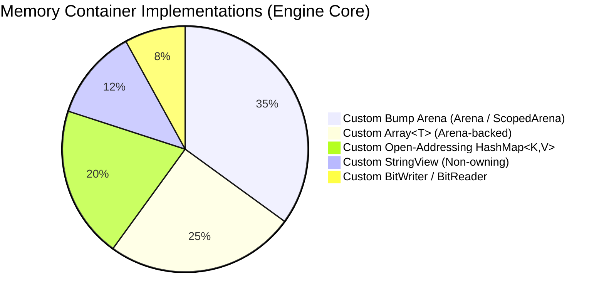

# Static Analysis

---

## 1. Codebase Volume
Analysis generated by `cloc v2.10` over `include/`, `src/`, and `test/`:

| Language     | files | blank | comment | code |
|--------------|-------|-------|---------|------|
| C++          | 12    | 860   | 363     | 3566 |
| C/C++ Header | 17    | 341   | 307     | 1229 |
| SUM:         | 29    | 1201  | 670     | 4795 |

-------------------------------------------------------------------------------
---

## 2. ALL ADTs are self built from primitive types and C++ core




## 3. Exported ABI Symbol Audit (`nm -C`)

Static symbol extraction from `dashboard/libeduroute.so`:

```
00000000000cfc30 T eduroute_build_wire_packet
00000000000da80d T eduroute_compress_delta
00000000000ce925 T eduroute_create
00000000000cfad0 T eduroute_destroy
00000000000d7205 T eduroute_get_arena_Memory_used
00000000000d637e T eduroute_get_collusion_edges
00000000000daf45 T eduroute_get_compression_stats
00000000000d7a7f T eduroute_get_dag_history_size
00000000000d747e T eduroute_get_dag_latest
00000000000d7389 T eduroute_get_dag_node_count
00000000000d5308 T eduroute_get_top_k
00000000000d04af T eduroute_ingest_packet
00000000000db5ae T eduroute_ingest_recovered_answer
00000000000cfb2a T eduroute_register_question
00000000000d8133 T eduroute_wal_acknowledge
00000000000d7f4e T eduroute_wal_acknowledged_sequence
00000000000d8c87 T eduroute_wal_append_unacked
00000000000d7d69 T eduroute_wal_last_sequence
00000000000d828f T eduroute_wal_peek_next
00000000000d7b84 T eduroute_wal_pending_count
00000000000d9748 T eduroute_wal_recover_and_apply_next
```

All 21 exported symbols possess C-linkage (`extern "C"`), clean name demangling, and strict 64-bit alignment compatibility with standard foreign function interfaces (FFI).

---

## 4. Algorithmic Complexity Table

| Engine Operation | Algorithm / Structure | Time Complexity | Space Complexity |
|---|---|---|---|
| Ingest Packet MAC Verification | FNV-1a Hash Accumulator | $O(L)$ where $L$ = payload bytes | $O(1)$ |
| Question Selection | IRT Fisher Information Maxima | $O(Q)$ where $Q$ = bank size | $O(1)$ |
| Ability Rating Update | Newton-Raphson Optimization | $O(1)$ (bounded $\le 10$ iterations) | $O(1)$ |
| Live Percentile Calculation | Fenwick Binary Indexed Tree | $O(\log M)$ ($M \le 10001$) | $O(M)$ |
| Exact Live Rank Query | Order-Statistic AVL Tree | $O(\log N)$ ($N$ = students) | $O(N)$ |
| Top-$K$ Leaderboard Export | Augmented AVL In-Order Walk | $O(K + \log N)$ | $O(K)$ |
| Plagiarism Fingerprinting | K-mer Rabin-Karp Winnowing | $O(L)$ where $L$ = text length | $O(L)$ |
| Cheating Cluster Merging | Disjoint Set Union (DSU) | $O(\alpha(N))$ nearly $O(1)$ | $O(N)$ |
| Answer Revision Delta | Dynamic Huffman Binary Tree | $O(L + \Sigma \log \Sigma)$ ($\Sigma = 256$) | $O(\Sigma)$ |
| On-Disk WAL Framing | Sequential Binary Write & Checksum | $O(L)$ | $O(1)$ |
| Merkle State Integrity | Cryptographic FNV-1a Chain | $O(L)$ | $O(1)$ |
| Memory Allocation | Bump Arena Allocator | $O(1)$ | $O(1)$ |
| Scratch Arena Cleanup | Monotonic Offset Reset | $O(1)$ | $O(1)$ |

---

## 5. Toolchain & Quality Assurance Matrix

The codebase is built and verified with:
- **Language Standard**: ISO C++20 (`-std=c++20`).
- **Compiler Warnings**: `-Wall -Wextra -Wshadow -Wconversion -Werror`.
- **Sanitizers**:
  - AddressSanitizer (`-fsanitize=address`) for buffer bounds and leak detection.
  - UndefinedBehaviorSanitizer (`-fsanitize=undefined`) for signed overflow, unaligned access, and type sanitization.
- **Static Analysis Tools**:
  - `clang-tidy`: Checked with modern C++ and bugprone analysis passes.
  - `cppcheck`: Verified with `--enable=all --inconclusive`.
  - `clang-format`: Used Enough